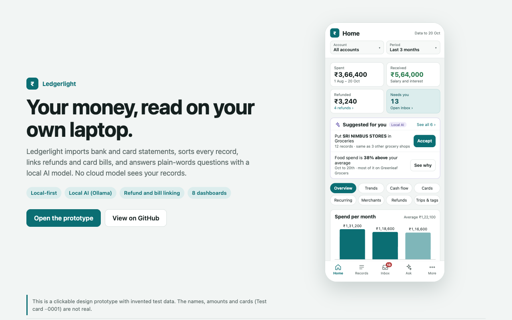

# Ledgerlight

**Your money, read on your own laptop.**

Ledgerlight imports bank and card statements, sorts every record, links refunds and card bills, and answers plain-words questions with a local AI model. No cloud model sees your records.

### [▶ Open the clickable prototype](https://himanshu15y.github.io/ledgerlight/)

[](https://himanshu15y.github.io/ledgerlight/)

## What is in the prototype

| Area | Screens |
|---|---|
| Dashboards | Overview, Trends, Cash flow, Cards, Recurring, Merchants, Merchant detail, Refunds, Category detail, Trips & tags |
| Inbox and More | Inbox (open work), More (import, data checks, backups, settings) |
| Ask, Records and refunds | Ask a question, AI answer, Records with period menu, Links, match by hand, refund linking |
| Suggested for you | Suggestions from the local AI model, suggestion chat |

21 phone screens. Tap a screen, then use its tabs and links to move around.

## Principles

- **Local-first.** Statements, records and the database stay on your own devices.
- **Local AI.** Questions and suggestions run on a local model (Ollama). They do not leave the laptop.
- **Generic engine.** Domain rules live in configuration files, not in code.

## Test data only

The prototype uses invented test data. The names, amounts and cards (for example *Test card ··0001*) are not real.

## Run the prototype locally

```bash
git clone https://github.com/himanshu15y/ledgerlight.git
cd ledgerlight
python3 -m http.server 8000
# open http://localhost:8000
```
